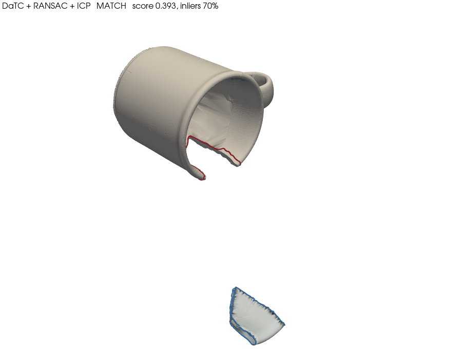
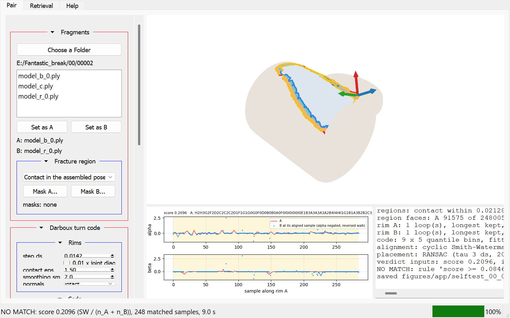

# DaTC: Darboux Turn Code for thin-shell fragment matching

Code for

> Vinh Nam Huynh, Hoang Ha Nguyen, Romain Raffin.
> **Matching Thin-Shell Fragments with a Darboux Turn Code of Their Fracture Boundaries.**
> RIVF 2026.

The fracture boundary of a thin-shell fragment (its *rim*) is a closed 3D curve
that lies on the original surface. DaTC records, at each sample along the rim,
how far the rim turns inside that surface (alpha) and out of it (beta), measured
in the Darboux frame built from the intact-side surface normal. The two angles
are quantised into a 9 x 5 symbol code (or rank-transformed), and two rims are
compared by cyclic local alignment (Smith-Waterman), trying both directions of
travel. The repository reproduces Table II of the paper from the meshes and
contains **DaTC Studio**, a PyQt application that runs the method on a pair of
fragments and shows each step.



*Fantastic Breaks object 00_00008. The two rims are matched by their Darboux turn
code; the piece is then placed by RANSAC on the matched samples and refined by
ICP on the fracture surfaces. The verdict is MATCH. Made with
`python app/datc_studio.py --gif E:\Fantastic_break\00\00008 figures/demo_00_00008.gif --icp`.
It was picked for its good placement: of the 60 mated pairs of the retrieval
pool it has the lowest RMS error after RANSAC and the third lowest after ICP. Over
all 60, ICP puts B within 2% of the diagonal D of its supplied pose for 47 pairs
(RANSAC alone: 3), and 12 pairs stay more than 30 degrees off (see* Placement
*below).*

## Download

Ready-to-run builds for Windows and Linux (x64) are on the
[releases page](https://github.com/nam-usth/DaTC/releases): unpack the archive
and start `DaTCStudio` (`DaTCStudio.exe` on Windows). No Python is needed. The
console program `datc` in the same folder runs the command-line uses:

```
datc --version
datc --selftest <Fantastic Breaks object folder> out.png
datc --gif <Fantastic Breaks object folder> out.gif --icp
datc --run-script experiments/make_table1.py
```

The *Retrieval* tab's four steps run the scripts of `experiments/` through
`datc --run-script`. The Linux build was made on Ubuntu 22.04 (glibc 2.35) and
needs the usual X11/OpenGL libraries of a desktop installation. The Windows
build is made with `python packaging/build_release.py` from the conda
environment of `environment.yml` plus PyInstaller 6.21.0; the Linux build by
`.github/workflows/release-linux.yml` with the same script.

## Contents

```
src/datc/
  geometry.py     normals, region boundary loops, resampling, smoothing, planarity
  descriptors.py  Darboux (alpha, beta) and Frenet (kappa, tau) turn angles
  rims.py         contact region -> longest boundary loop -> rim (one per component for PRESIOUS)
  alphabet.py     quantile symbol code, mirrored for the reversed walk of the mate
  kernels.py      Smith-Waterman and cyclic DTW kernels (numba)
  scoring.py      pair scores and score matrices for every arm of Table II
  normalise.py    z and rank transforms of the tuned comparison
  stats.py        expected-tie top-k, object-level sign test, ROC AUC / AP
  datasets.py     Fantastic Breaks and PRESIOUS loaders, the three rim pools
  pose.py         RANSAC + Kabsch placement from the matched samples; point-to-plane ICP
  pipeline.py     one pair of fragments end to end, with placement and match verdict (used by the app)
experiments/
  build_pools.py      the three rim pools, cached under cache/
  table1_reviewed.py  Table II, upper block
  table1_tuned.py     Table II, lower block
  make_table1.py      prints Table II and checks every cell against the paper
  pair_verdict.py     fits and measures the app's match / no-match rule
app/datc_studio.py    DaTC Studio (PyQt5 + PyVista)
packaging/            PyInstaller spec and the release build script
splits/               the object lists of every pool and split
reference/            the values printed in the paper (make_table1.py) and the verdict rule (verdict.json)
tests/                kernels against slow references; invariance and tie-rule checks
```

## Install

Python 3.9 or later.

```
pip install -r requirements.txt
```

or `conda env create -f environment.yml`. The code was run with numpy 2.0.2,
scipy 1.13.1, pyvista 0.46.5, vtk 9.4.2, numba 0.60.0, scikit-learn 1.5.2 and
PyQt5 5.15.10 on Windows 11.

## Data

Neither dataset is redistributed here.

| dataset | where to get it | layout expected |
|---|---|---|
| Fantastic Breaks (Lamb et al., CVPR 2023) | the authors' release | `<root>/<category>/<object>/model_b_0.ply`, `model_r_0.ply` |
| PRESIOUS (Theoharis and Papaioannou 2013) | https://www.ntnu.edu/presious/3d-data-sets | `<root>/<Object>/**/<Fragment>_low.obj`, `<Fragment>_med.obj`, `*_Reassembled.obj` |

Our copy of Fantastic Breaks holds 132 of the 150 pairs of the public release;
every object used in the paper is listed in `splits/fantastic_breaks.json`.
PRESIOUS objects used: DoraBlock, DoraColumn, DoraColumnBase, DoraEmbrasure,
Tombstone, at the `_med` resolution. Fantastic Breaks fragments are already in
their assembled pose; PRESIOUS poses are recovered from the reassembled file.

Set the roots once:

```
set DATC_FB_ROOT=E:\Fantastic_break
set DATC_PRESIOUS_ROOT=D:\data\presious
```

(or pass `--fb-root` and `--presious-root` to `build_pools.py`).

## Reproduce Table II

Table II is the retrieval table of the camera-ready paper (Table I lists the evaluation sets). The scripts keep their earlier names, `table1_*.py` and `make_table1.py`.

```
python -u experiments/build_pools.py            # three pools -> cache/        (about 45 min)
python -u experiments/table1_reviewed.py        # upper block -> results/      (a few minutes)
python -u experiments/table1_tuned.py           # lower block -> results/      (a few minutes)
python experiments/make_table1.py               # prints Table II, checks it, exit code 0 if it matches
```

Times are for an 8-core laptop. `make_table1.py` compares every percentage to
the value printed in the paper (to its 0.05 precision), the object-level
sign-test counts exactly and the detection AUC / AP to 0.0005, and ends with
`TABLE II REPRODUCED` or `TABLE II MISMATCH`. Its output is written to
`results/table1.md`. The same four steps can be run from the *Retrieval* tab
of DaTC Studio.

What each block measures:

| block | pool | protocol |
|---|---|---|
| upper | Fantastic Breaks retrieval pool, 60 objects, 120 rims; PRESIOUS, 5 objects, 47 rims | settings fixed before this table (smoothing 2 samples, 9 x 5 code with bins fitted on the pool without labels); a query ranks every other rim of its pool |
| lower, test half | 30 test objects of the retrieval pool, 60 rims | configurations selected on the 30 development objects over the same 63-point grid; transforms fitted on development rims and frozen; a query ranks the other 59 test rims |
| lower, held-out | 46 objects outside the pool, 92 rims | every setting frozen; transforms fitted on the 120 pool rims |
| lower, PRESIOUS | 47 rims | transforms fitted on its own rims (label free) |

Ties count at their expected rank. The selection over the 63-point grid is not
repeated here: `table1_tuned.py` evaluates the three selected configurations
(listed at the top of the script).

## DaTC Studio

```
python app/datc_studio.py                                   # empty window
python app/datc_studio.py E:\Fantastic_break\00\00002       # one Fantastic Breaks object
python app/datc_studio.py frag_a.ply frag_b.ply             # any two fragments in assembled pose
```

*Pair* tab: choose two fragments, press **Run DaTC**. The 3D view shows the
fracture regions, the two rims, the samples the alignment matched, and the
Darboux frame (t, g, n) at a sample chosen with the slider; below it, alpha and
beta of rim A with the aligned samples of rim B, and a log naming the function
behind every step. B can be placed by the RANSAC fit of the matched samples,
optionally refined by ICP, and the pairing exported as a GIF. A MATCH / NO
MATCH verdict is always shown. The computation runs in a worker thread.
*Retrieval* tab: run the four reproduction steps, then browse each query's
ranking. A selected query and its first candidate (or its mate) are drawn in a
2 x 3 grid: the two fragments, the placement; the two rims coloured by their
code, and the Smith-Waterman matches between them.
*Help* tab: `app/README.md`.




A pairing GIF without the window:

```
python app/datc_studio.py --gif E:\Fantastic_break\00\00008 pairing.gif [--icp]
```

### Placement

RANSAC (Fischler and Bolles 1981) fits a rigid transform to the matched rim
samples: 2000 minimal samples of three pairs, Kabsch on each, inliers within
3 ds, refit on the largest consensus. Of the two directions of travel, the one
whose fracture planes face each other is kept. *Refine by ICP on the fracture
regions* (Placement group) then runs point-to-plane ICP (Chen and Medioni 1992)
of B's fracture-region vertices onto A's, from the RANSAC pose; point pairs
farther apart than the reject distance (default 3 ds, the RANSAC inlier
distance, not tuned) are dropped. ICP changes the placement only; the verdict
stays on the RANSAC fit, which its thresholds were measured with.

Measured by `experiments/placement_icp.py` on the 60 mated pairs of the Fantastic
Breaks retrieval pool (`results/placement_icp/placement_icp.json`), against the
pose the dataset supplies; D is the bounding-box diagonal of the assembled pair:

| pairs out of 60 | RANSAC | RANSAC + ICP |
|---|---|---|
| RMS error within 1% of D | 1 | 30 |
| RMS error within 2% of D | 3 | 47 |
| RMS error within 5% of D | 40 | 48 |
| rotation error below 5 degrees | 38 | 47 |
| rotation error below 30 degrees | 44 | 48 |
| median RMS error (% of D) | 3.24 | 0.95 |

ICP lowered the RMS error on 53 pairs and raised it on 6. On 12 pairs the result
stays more than 30 degrees off: ICP starts from the RANSAC pose and cannot undo a
turned-over one. The parameters were not tuned. The counterpart of a Fantastic
Breaks pair is computed by the dataset from the broken piece's own scan, so its
fracture surface is close to a copy of the piece's and ICP has an easier target
here than it would have between two independent scans.

### Match verdict

The verdict answers whether the two rims are mates. Its
rule, fitted by `experiments/pair_verdict.py` on the development half of the
Fantastic Breaks retrieval pool (Youden J) and stored in
`reference/verdict.json`, is: score >= 0.0847 **and** inlier share >= 0.597,
where the inlier share is the fraction of matched samples within 3 ds after
RANSAC. Measured without refitting:

| pairs | mates accepted | non-mates accepted |
|---|---|---|
| Fantastic Breaks test half (30 mated, 1740 unmated) | 86.7% | 16.2% |
| PRESIOUS (26 mated, 1055 unmated) | 65.4% | 52.9% |

So on Fantastic Breaks about one non-mate pair in six is still called MATCH,
and on PRESIOUS the verdict barely separates mates from non-mates. Read it as
a screening flag, not as a decision. The verdict always uses the 9 x 5 code
fitted on the two rims, the setting it was measured with.

The rule is refitted with

```
python -u experiments/pair_verdict.py     # about 5 min with --procs 8
```

It is not part of the paper; the paper reports retrieval ranks only.

A headless check, used before every release:

```
python app/datc_studio.py --selftest E:\Fantastic_break\00\00002 figures/app/selftest_00_00002.png
```

It runs the pair through the window's worker, asserts that the rims equal those
of `datasets.fb_object_rims` and that a verdict is given, writes the GIF, and,
when the pools are built, draws three retrieval pairs (a query whose first
candidate is its mate, a query whose first candidate is not, and that query
with its mate) and saves screenshots. The object used, 00_00002, is itself one
of the missed mates: its two rims get NO MATCH (inlier share 29.8%).

## Tests

```
python -m pytest tests
```

The compiled kernels are compared with the slow NumPy implementations that
produced the paper's matrices, and must agree exactly. Other tests check rigid
invariance, that the reversed walk negates alpha and keeps beta, that the
mirrored symbol code equals the code of the negated angles, the Frenet values of
a helix, and the tie rule.

## Scope and known limits

This release covers the method and Table II. The other experiments of the paper
(partial overlap, edge wear and warp, resolution, the normal-source ablation)
are not in this repository. The limits stated in the paper apply: the fracture
region is given (contact in the assembled pose, or a mask), not detected; the
counterpart rims of Fantastic Breaks come from the same scan, so the retrieval
pool is the easy case; the Smith-Waterman parameters (match 2, gap open -4,
gap extend -0.6, weights 6 and 4) were set by hand and never tuned.

## Citation

```
@inproceedings{huynh2026datc,
  author    = {Huynh, Vinh Nam and Nguyen, Hoang Ha and Raffin, Romain},
  title     = {Matching Thin-Shell Fragments with a Darboux Turn Code of Their Fracture Boundaries},
  booktitle = {Proc. RIVF International Conference on Computing and Communication Technologies},
  year      = {2026}
}
```

## License

MIT, see `LICENSE`. The datasets keep their own licenses.
